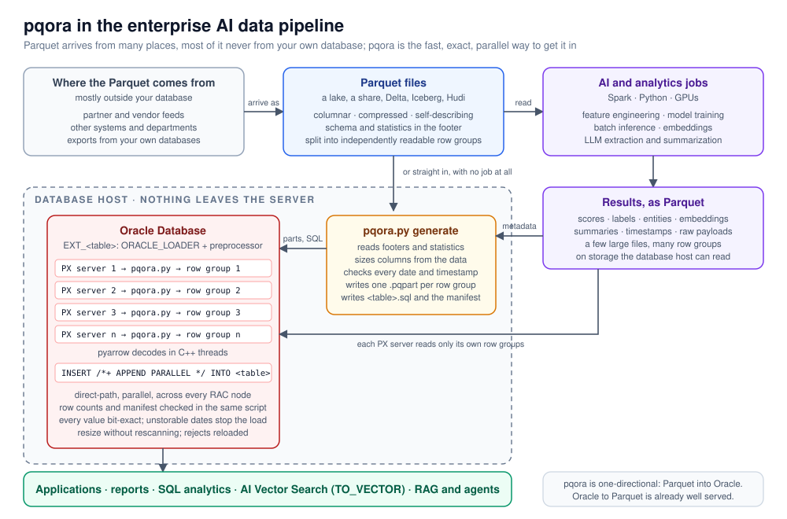

# pqora: parallel Parquet loader for Oracle Database

**Load Parquet files from a data lake or AI pipeline into Oracle tables, in
parallel, with every value exactly as it was written.**

[](LICENSE)
[](#requirements)
[](#requirements)
[](https://github.com/nextria-ca/oracle_parquet_reader/actions/workflows/ci.yml)

**pqora** loads Parquet files into Oracle Database using only what Oracle
already ships: an `ORACLE_LOADER` external table whose *preprocessor* is a
single Python file, `pqora.py`. Every Parquet row group becomes one Oracle
parallel work unit, so one large file is decoded by many CPUs at once, on
every node of a RAC cluster. Every value arrives bit-for-bit as it left, and
the bundled test kit proves it with checksums computed on both sides.

```bash
python3 pqora.py generate /data/sales/ --table SALES --out-dir /u01/pqora --sample-size all --dop 16
sqlplus scott@pdb @/u01/pqora/sales.sql      # creates, loads in parallel, verifies
```

pqora was built and is maintained by [Nextria](https://nextria.ai). It is
released under the Apache License 2.0.

- [Why this matters](#why-this-matters)
- [How it works in one picture](#how-it-works-in-one-picture)
- [Quick start](#quick-start)
- [Main features](#main-features)
- [Requirements](#requirements)
- [Documentation](#documentation)
- [Repository layout](#repository-layout)
- [Project status](#project-status)
- [Contributing](#contributing)
- [License](#license)

---

## Why this matters

### What Parquet files are

[Apache Parquet](https://parquet.apache.org/) is the standard file format of
data lakes and of the modern analytics and AI stack. A Parquet file stores a
table **column by column** rather than row by row, which lets each column be
compressed and encoded in the way that suits its data, and lets a reader
fetch only the columns it needs. The file carries its own **schema** (names,
types, nested structures) and per-column **statistics** in a footer, so the
data is self-describing. Internally a file is divided into **row groups**:
horizontal slices of typically 64 MB to 1 GB that can each be read on their
own.

Almost everything that produces data at scale writes Parquet by default:
Spark and Databricks, Snowflake and BigQuery exports, pandas, Polars and
DuckDB, Hugging Face datasets, and the table formats built on top of it
(Delta Lake, Apache Iceberg, Apache Hudi). If an organization runs an AI or
analytics pipeline, its intermediate and final results are very likely
Parquet files.

### The problem: the return trip into Oracle

Oracle Database is where a large share of the world's operational data lives:
the systems of record for finance, logistics, healthcare, government and
telecom. Getting data **out** of Oracle into a data lake is a solved problem.
Getting results **back into** Oracle, at scale and without altering them, is
not.

The core problem is **time that does not scale**. An AI pipeline hands you a
50 GB Parquet file. The database server has 64 cores. The load still takes
all night, because every standard loader, including Oracle's own, treats one
file as one job for one CPU. The other 63 cores idle, and buying more
hardware changes nothing. Around that sit the familiar problems:

- **Converting to CSV first** costs a full extra copy of the data and brings
  back every CSV problem: delimiters and newlines inside values, NULL vs
  empty string, floats rounded by text formatting, binary data hex-encoded.
- **Readers that treat one file as one unit of work** cannot spread a large
  file over many CPUs. A dataset that arrives as a handful of multi-gigabyte
  files loads on a handful of cores, however large the server.
- **Oracle's own Parquet reader** (`ORACLE_BIGDATA`) rejects some real-world
  files because of format and encoding differences, and it does not split a
  single file across parallel workers.
- **Silent surprises**: a date in year 0, a date in the 1582 calendar gap, a
  string one byte longer than its column. Some tools reject the row, some
  change the value, and nobody notices for months.

### Where AI pipelines meet Oracle

A typical enterprise AI pipeline looks like this: data is exported from
Oracle into a lake, jobs produce features, predictions, embeddings and
extracted text, and the results are written back as Parquet.



The return arrow is where many projects stall. Model outputs are only useful
once they sit next to the data the business actually runs on, and that
usually means a table in Oracle. pqora is built for exactly that step, and it
handles the kinds of values AI pipelines produce:

| AI pipeline output | How it arrives in Oracle |
|---|---|
| Scores, probabilities, regression outputs (`float`, `double`) | `BINARY_FLOAT` / `BINARY_DOUBLE`, bit-exact, including NaN and ±Inf |
| Labels, classes, entity IDs | `VARCHAR2` / `NUMBER`, sized from the data |
| Extracted entities and structured fields (nested `struct`) | flattened to `PARENT#CHILD` columns |
| Multi-label results, token lists, tags (`list`) | JSON text, column suffixed `_LST` |
| Embeddings (`list<float>`) | JSON arrays, which `TO_VECTOR()` accepts in Oracle 23ai and later for AI Vector Search |
| LLM-generated summaries and long text | `VARCHAR2` or `CLOB`, with large values optionally staged to a side table so they do not slow the bulk load |
| Event and sensor timestamps | `TIMESTAMP(9)`, to the nanosecond, time zones normalized to UTC |
| Document hashes, raw payloads (`binary`) | `RAW` / `BLOB`, raw bytes, never hex-encoded |

The same path works in the other direction of the AI story: curated
documents, chunks and metadata prepared in the lake can be loaded into
Oracle so that retrieval-augmented generation and agents can query them with
SQL and vector search right beside the operational data.

Three properties matter more for AI workloads than for a routine data
migration, and they drive pqora's design:

1. **Load time that scales with the hardware you own.** Batch inference and
   embedding jobs tend to emit a few very large files. pqora parallelizes by
   row group, so one 50 GB file with 64 row groups keeps 64 Oracle parallel
   servers busy, across every node of a RAC cluster. In the test kit, eight
   parallel workers finished the same scan 5.6 times faster than one; large
   files split into far more than eight pieces.
2. **Exactness you can audit.** A model's outputs that are silently rounded,
   truncated or shifted on load poison every decision made from them and
   make audits impossible. pqora never stores a value differently from the
   source without an explicit option, stops loudly otherwise, and ships a
   test kit that compares per-column checksums computed by pyarrow with the
   same checksums computed in SQL.
3. **Nothing leaves the server.** pqora runs inside the database host as a
   preprocessor. There are no agents, connectors, cloud services or new
   database features involved, which matters for regulated and sovereign
   environments where the AI platform must sit beside the Oracle estate, not
   route data through something else. It runs on long-lived enterprise Linux
   (Oracle Linux 7, Python 3.6, pyarrow 6.0.1).

pqora is deliberately one-directional: Parquet into Oracle. Exporting Oracle
to Parquet is already well served by Spark, Oracle's own tools and many
others.

### What pqora does about it

`generate` reads the Parquet footers, sizes every column from the data,
checks every date and timestamp against Oracle's range, and writes one small
`.pqpart` file per row group plus a complete, reviewable `<table>.sql`. Oracle
hands the part files to its parallel execution servers; each runs `pqora.py`,
which decodes its row groups with pyarrow's multi-threaded C++ engine and
streams length-prefixed records to Oracle. A parallel direct-path `INSERT`
does the rest. **[Why pqora](docs/WHY_PQORA.md)** explains all of this with
diagrams.

---

## How it works in one picture


```
Parquet files ──► pqora.py generate ──► <table>_0001.pqpart … (one per row group = parallel work unit)
                                        <table>.sql             (external table, target table, INSERT, checks)
                                        <table>_manifest.json   (everything generate decided)
                                        pqora.sh                (preprocessor wrapper)

SELECT/INSERT … FROM EXT_<table>  ──►  Oracle PX servers, one per .pqpart
                                        └─► pqora.sh <part> ──► pqora.py stream mode ──► stdout records
                                                                 (reads only that part's row groups)
```

## Quick start

```bash
# 1. look at the files: rows, row groups, column types/encodings/codecs, parallelism
python3 pqora.py /data/sales/*.parquet

# 2. generate part files, DDL and wrapper (one run = one table)
python3 pqora.py generate /data/sales/ --table SALES --out-dir /u01/pqora --sample-size all --dop 16

# 3. as DBA, once: one directory object for everything
#      CREATE DIRECTORY PQORA_PARTS AS '/u01/pqora';
#      GRANT READ, WRITE, EXECUTE ON DIRECTORY PQORA_PARTS TO <schema>;

# 4. load
sqlplus <schema>@<pdb> @/u01/pqora/sales.sql
```

`sales.sql` creates `EXT_SALES` (external) and `SALES` (target), loads with a
parallel direct-path INSERT, compares loaded vs expected rows and shows the
manifest and the sampling results as tables.

To try it without a database first, the self-test generates Parquet files
with every supported type and the nasty cases, and `verify` decodes the
stream exactly as Oracle would:

```bash
python3 pqora_selftest.py make /tmp/t --big-rows 300000 --blob-mb 1,5
python3 pqora.py generate /tmp/t/types.parquet --table T --out-dir /tmp/t/p --sample-size all
python3 pqora.py verify /tmp/t/p/t_*.pqpart
```

## Main features

- One parallel work unit per row group (or grouped with `--target-size`),
  largest parts first so the load does not end with one straggler.
- Exact data: every value round-trips (verified by checksum comparison in
  Oracle); NULL vs empty LOB preserved; numbers, floats (bit-exact), decimals,
  timestamps to nanoseconds, binary, Unicode, embedded newlines and NUL bytes.
- Column sizing from data (`--sample-size all`), with counts per Oracle size
  band (VARCHAR2 4000 / extended 32767 / CLOB); sampling results are cached
  per sample size (`<table>_sample_cache.json`) so later runs are instant.
- Nested data: structs flattened to `PARENT#CHILD` columns, lists (`_LST`)
  and maps as JSON text.
- Date safety: every date/timestamp checked against Oracle's range (from
  Parquet statistics, so usually free), `--out-of-range-dates error|null|clamp`,
  interval-like date columns (years 0000-0001) loaded as numbers,
  `--column-type` overrides.
- Large values: `--stage-large-records` keeps CLOBs out of the bulk load and
  diverts records with large values to a `<table>_CLOB` table.
- Size fixes without rescanning: `resize --field-size` / `--auto-field-size-fix`
  (reads the failed load's logs).
- Rejected rows: `EXT_<table>_BAD` reads Oracle's bad files back with the same
  column definitions, so good rows go in now and the rest later.
- Tuning: `--threads`, `--pre-buffer` (large coalesced reads, good for NFS),
  multi-process sampling.
- Generated SQL that explains itself: a comment on every column with its
  source type and size decision, plus queries that read the manifest and the
  sampling cache straight from SQL.
- A self-contained test kit (`kit/`) that runs every experiment on a database
  server unattended and returns one report.

## Requirements

| Where | What |
|---|---|
| Database server | Oracle Database 19c or later (tested on 19c and 23ai/26ai), Linux, `sqlplus` for the generated scripts |
| Python on the database server | Python 3.6 or newer, `pyarrow` 6.0.1 or newer, `numpy`; readable by the database OS user |
| Database privileges | one directory object with READ, WRITE, EXECUTE on it; optionally RESUMABLE |
| Storage | the Parquet files, the parts directory and the log directory readable by the database OS user, on a shared file system with the same path on every node for RAC |

`pqora.py` is intentionally a single file with no dependencies beyond pyarrow
and numpy, so it can be copied to a server by hand. The Oracle Database
Appliance with Oracle Linux 7 (Python 3.6.8, pyarrow 6.0.1, numpy 1.19.5) is
the oldest supported platform and is tested as such. Newer Python and pyarrow
versions are tested in CI.

## Documentation

| Document | For |
|---|---|
| [docs/WHY_PQORA.md](docs/WHY_PQORA.md) | Overview with diagrams: parallelism, RAC, exactness, safety checks |
| [docs/USER_GUIDE.md](docs/USER_GUIDE.md) | Setup, workflow, all options, generated files, type mapping, dates, large records, tuning, logs, troubleshooting |
| [docs/DEVELOPER.md](docs/DEVELOPER.md) | Architecture, code map, data structures and file formats, stream format, pipelines, testing, release |
| [docs/DESIGN_NOTES.md](docs/DESIGN_NOTES.md) | Why it is built this way; verified Oracle / pyarrow behaviours; open points |
| [kit/README.txt](kit/README.txt) | Running the test kit on a database server |
| [CHANGELOG.md](CHANGELOG.md) | Version history |
| [CONTRIBUTING.md](CONTRIBUTING.md) | How to set up, test and submit changes |
| [CLAUDE.md](CLAUDE.md) | Orientation for AI coding assistants working on this repo |

## Repository layout

| Path | What |
|---|---|
| `pqora.py` | The tool (single file): inspect, generate, stream (preprocessor), verify, resize |
| `pqora_selftest.py` | Test data generator and Oracle-vs-pyarrow checksum comparison |
| `kit/run_kit.sh` | Unattended test kit runner (all experiments, one report tarball) |
| `kit/make_kit.sh` | Builds `dist/pqora_kit_<version>.tar.gz` |
| `kit/README.txt` | Kit instructions (shipped inside the tarball) |
| `docs/` | User guide, developer guide, design notes, overview with diagrams |
| `parquet_inspect.py` | Earlier prototype for the native `ORACLE_BIGDATA` driver (kept for reference, not maintained) |
| `.github/workflows/ci.yml` | Lint, Python 3.6 compatibility check and the offline self-test on old and new pyarrow |
| `dist/` | Built kit tarballs (git-ignored) |

## Project status

pqora is in production use and actively maintained by Nextria. The current
version is 1.4; see the [changelog](CHANGELOG.md). It was built to load
real-world data-lake exports onto an Oracle Database Appliance where the
native Parquet driver failed, and it has been verified with the test kit on
Oracle 19c and 23ai/26ai. Points not yet verified on every platform are
listed at the end of the [design notes](docs/DESIGN_NOTES.md).

Issues and pull requests are welcome. If you run the kit on a platform not
listed here, the report tarball it produces is the most useful thing you can
attach to an issue.

## Contributing

See [CONTRIBUTING.md](CONTRIBUTING.md) for the development setup, the hard
compatibility constraints (Python 3.6, pyarrow 6.0.1, single file) and the
checks every change must pass. Security issues should be reported privately
as described in [SECURITY.md](SECURITY.md). This project follows the
[code of conduct](CODE_OF_CONDUCT.md).

## License

Copyright 2026 Nextria. Licensed under the [Apache License, Version 2.0](LICENSE).

Oracle, Oracle Database, Oracle Linux, Oracle Database Appliance and Real
Application Clusters are trademarks or registered trademarks of Oracle
and/or its affiliates. Apache Parquet and Apache Arrow are trademarks of the
Apache Software Foundation. This project is not affiliated with or endorsed
by Oracle or the Apache Software Foundation.

---

[Nextria](https://nextria.ai) builds AI platforms for organizations that keep
their data on their own infrastructure. pqora is one of the pieces that lets
those platforms work with the Oracle systems already in place.
