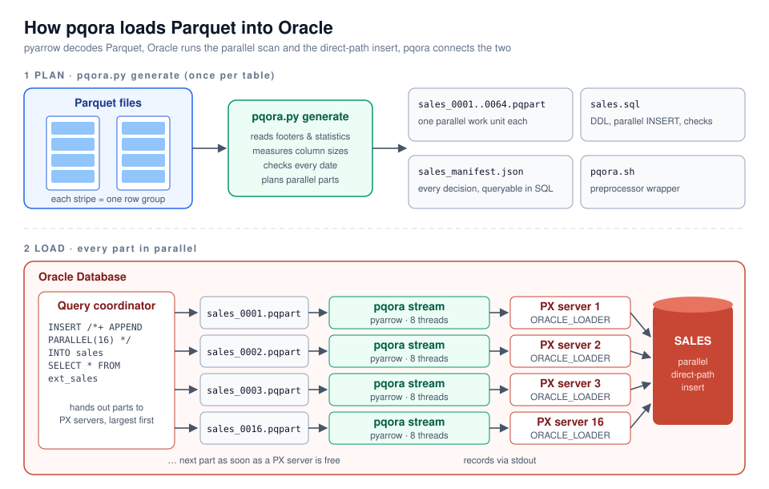
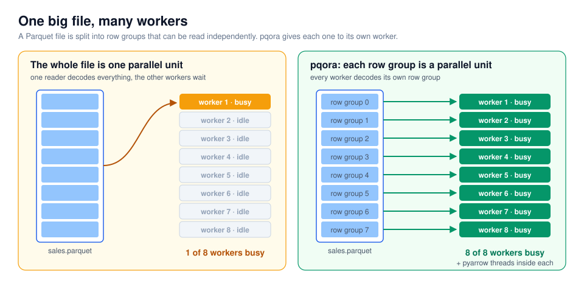
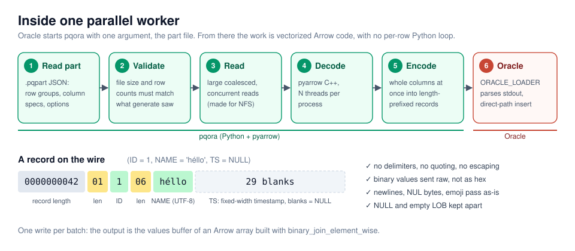
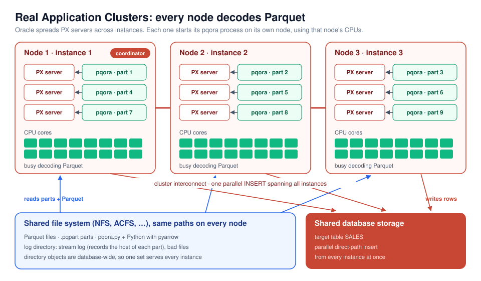
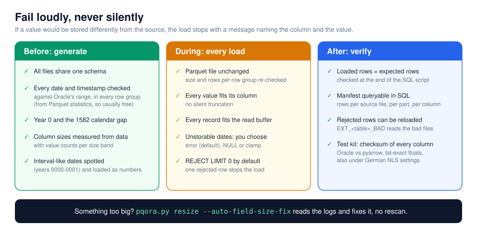
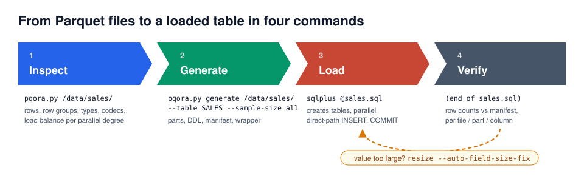
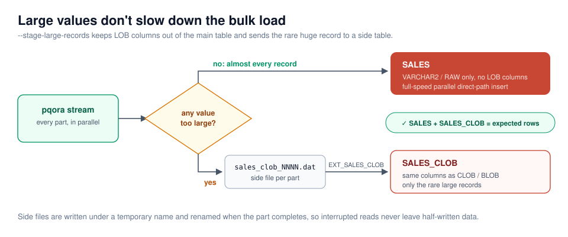

# Why pqora

**Parquet into Oracle at full parallel speed, with every value arriving exactly
as it left.**

pqora is one Python file that turns any set of Parquet files into a parallel
Oracle external table. Oracle does what it is best at - parallel scans and
parallel direct-path inserts - and pyarrow does what it is best at - decoding
Parquet in multi-threaded C++. pqora is the thin, careful layer in between.



```bash
python3 pqora.py generate /data/sales/ --table SALES --sample-size all --dop 16
sqlplus scott@pdb @sales.sql          # creates, loads in parallel, verifies
```

That's the whole load.

---

## The problem

Parquet is the standard file format of data lakes, Spark, and every modern
export tool. Oracle is where a lot of that data has to end up. Getting it there
is harder than it looks, and the biggest problem is **time that does not
scale**: a 50 GB Parquet file on a 64-core database server still loads on
one core, because standard loaders, Oracle's own included, treat one file as
one unit of work. More hardware does not make the load faster. The other
problems are smaller but just as real:

- **Converting to CSV first** costs a full extra copy of the data. It also
  brings the classic CSV problems: delimiters and newlines inside values,
  NULL vs empty string, floats rounded by text formatting, binary data that has
  to be hex-encoded.
- **Readers that treat a file as the unit of work** can't spread one large
  Parquet file over many CPUs. When a dataset is a handful of big files,
  parallelism stops at the file count and the rest of the server idles.
- **Silent surprises**: a date in year 0, a date in the 1582 calendar gap, a
  string one byte longer than its column. Some tools reject the row, some
  change the value, and you find out months later.

pqora was built to remove all of these.

---

## Fast: three layers of parallelism

### 1. Every row group is a parallel work unit

A Parquet file is made of **row groups** that can each be read on their own.
pqora gives each row group, or a small group of them with `--target-size`,
its own location file. Oracle hands location files to parallel execution
(PX) servers, so a single 50 GB file with 64 row groups keeps 16, 32 or 64
workers busy.



Parts are listed **largest first**, so the long ones start early and the run
doesn't end with one straggler. Measured in the test kit on a 2-million-row
table: a scan at parallel degree 8 took 1.5 s against 8.4 s at degree 1, a
5.6x speed-up from the same file on the same machine. The ceiling is the
number of row groups, typically dozens to hundreds in a large file. The `inspect` report shows how evenly the
parts balance at each parallel degree *before* you load anything.

### 2. Multi-threaded inside every worker

Each pqora process decodes its row group with pyarrow's C++ engine using
several threads (`--threads`, default 8). Records are built **one whole column
at a time** with Arrow compute functions. There is no per-row Python loop on
the hot path, and each batch goes to Oracle in a single write.



The output format was chosen for both speed and safety. Every field carries
its length in front, so there is nothing to escape and nothing to parse
character by character. Binary data travels as raw bytes, not hex.

### 3. Oracle's own parallel engine does the rest

On the database side nothing new is involved: the standard `ORACLE_LOADER`
driver, Oracle parallel query, and a **parallel direct-path insert**
(`INSERT /*+ APPEND PARALLEL */`). Those are the fastest load paths Oracle
has. Rows are written straight into new blocks above the high-water mark,
bypassing the buffer cache, from every PX server at once. A generated one-line
`CREATE TABLE … COMPRESS FOR QUERY HIGH AS SELECT` is ready too, if your
storage supports Hybrid Columnar Compression.

### Built for network storage

Row groups are fetched with **large, coalesced, concurrent reads**
(`--pre-buffer`), which is what NFS and other network file systems need to
reach full throughput. Very large row groups switch to bounded 8 MB streaming
reads, so memory stays predictable.

---

## Scales across a RAC cluster

Each PX server starts its own pqora process **on the node where that PX server
runs**. On Real Application Clusters, Oracle spreads PX servers across
instances, so **the CPUs of every node** decode Parquet at the same time. One
`INSERT` statement can use the whole cluster.



What it takes:

| Requirement | Why |
|---|---|
| Parquet files, the parts directory and the log directory on a **shared file system** (NFS, ACFS, …) with the **same path on every node** | Any node may get any part. Side files and bad files written on one node may be read on another. |
| Python with pyarrow, `pqora.py` and `pqora.sh` at the same path on every node (a shared mount is easiest) | The wrapper uses absolute paths. |
| PX servers allowed to span instances (the default; see `PARALLEL_FORCE_LOCAL`, services and `PARALLEL_INSTANCE_GROUP` to choose which nodes) | Standard Oracle parallel execution settings. |

Directory objects are database-wide, so one set covers every instance. The
stream log records the **host** of every part, so you can see exactly how the
work was spread across the cluster.

---

## Exact: every value round-trips

pqora's rule is simple: **a value is never stored differently from the source
unless you ask for it**. This is proven, not just promised. The bundled test
kit computes a checksum of every column with pyarrow and the same checksum
with SQL in Oracle, then compares them. It runs 42 checks, including a run
under German NLS session settings.

| Data | What arrives in Oracle |
|---|---|
| `float` / `double` | `BINARY_FLOAT` / `BINARY_DOUBLE`, **bit-exact**, including NaN, ±Inf and subnormals |
| `decimal(38, s)` | `NUMBER(38, s)`, every digit |
| Timestamps (s, ms, µs, ns), with or without a time zone | `TIMESTAMP(0…9)`, down to the nanosecond (time zones normalized to UTC) |
| Strings | UTF-8 as-is: emoji, embedded newlines, quotes, control characters, NUL bytes |
| Binary | `RAW` / `BLOB` raw bytes, tested with 100 MB values |
| NULL vs empty | kept apart, including NULL vs empty CLOB/BLOB |
| Nested structs | flattened to `PARENT#CHILD` columns |
| Lists, maps | JSON text (lists named `_LST`) |

### Fail loudly, never silently



Dates are a good example. Oracle stores only years 0001-9999, and in Oracle's
calendar the days 1582-10-05 to 1582-10-14 don't exist. Parquet allows any
of these. pqora checks **every date and timestamp column in every row group**
before the load. It uses the Parquet min/max statistics, so the check is
usually free. If something can't be stored, `generate` tells you up front, and
the load stops unless you choose `--out-of-range-dates null` or `clamp`.
Columns that only hold years 0000-0001 are recognized as disguised intervals
and loaded as numbers, with a comment explaining it.

---

## Zero guesswork: the SQL writes itself

`generate` produces a complete, reviewable `<table>.sql`, runnable top to
bottom in SQL\*Plus:

- the external table, with **a comment on every column** explaining its
  source type and size decision;
- the target table, the parallel direct-path `INSERT`, and the `COMMIT`;
- a row-count check of loaded vs expected rows;
- queries that read the **manifest** (`<table>_manifest.json`) straight from
  SQL: rows per source file, per part, per column;
- the full source file report, as comments.

Column sizes come **from your data**, not from guesses. `--sample-size all`
measures the real maximum length of every string and binary column and counts
how many values fall in each Oracle size band:

```sql
"S_LONG" CLOB, -- s_long: string, sampled max 16,127 B; <=4000 B: 8,711, 4001-32767 B: 9,471
```

You can see at a glance whether a column really needs a CLOB, or would fit in
`VARCHAR2(32767)` with `MAX_STRING_SIZE=EXTENDED`. Sampling runs in a process
pool, and the results are **cached**, so regenerating a table with different
options doesn't read the data again.



---

## Large values without the LOB penalty

A single CLOB column can slow down the entire bulk load. With
`--stage-large-records` the main table has no LOB columns at all. The rare
record with a huge value is diverted to a side table, and the row counts of
both are checked against the source.



---

## When something goes wrong, recovery is cheap

| Situation | What you do |
|---|---|
| A value is larger than its column | `pqora.py resize sales_manifest.json --auto-field-size-fix` reads the failed load's logs, widens exactly the columns that need it, and writes `sales_alter.sql`. **No rescan of the data.** |
| You want the good rows in now and the bad ones later | Set `REJECT LIMIT UNLIMITED`, load, then reload the rejects from `EXT_<table>_BAD`. It reads Oracle's bad files back with the same column definitions. |
| A Parquet file was replaced after `generate` | The load refuses it (size and row-group check) instead of loading a mix of old and new. Rerun `generate`. |
| Something failed inside a worker | The message appears in your SQL client (`KUP-04095 … pqora 1.4: <part>: <message>`), and the full text is in the stream log. |

---

## Runs where your database runs

- **One file, `pqora.py`.** Copy it to the server. Its only dependencies are
  pyarrow and numpy.
- **Python 3.6 and pyarrow 6.0.1 or newer.** It works on long-lived
  enterprise Linux servers such as Oracle Linux 7.
- **Nothing new in the database.** It uses the `ORACLE_LOADER` driver that
  ships with Oracle, a directory object, and a preprocessor. There are no
  agents, no connectors, and no services to run.
- **Any Parquet that pyarrow reads.** That covers every format version,
  encoding and codec, including files other readers reject.
- **A self-contained test kit** (`kit/`) runs every experiment unattended on
  your server and returns one report file. You can prove it on your own
  database before you trust it with your data.

---

## pqora at a glance

| | CSV export + loader | Whole-file Parquet reader | **pqora** |
|---|---|---|---|
| Extra copy of the data | yes | no | **no** |
| Parallel within one large file | depends on the loader | no | **yes, per row group** |
| Uses every node of a RAC cluster | possible | possible | **yes** |
| Delimiter / newline / NUL-byte safe | escaping needed | yes | **yes, length-prefixed** |
| NULL vs empty LOB | usually lost | depends | **kept** |
| Bit-exact floats, nanosecond timestamps | text rounding risk | depends | **yes, checksum-verified** |
| Unstorable dates | depends | depends | **detected before the load** |
| Column sizes | guessed | guessed | **measured, explained per column** |
| Fix a size error | reload | reload | **`resize`, no rescan** |

---

## Honest limits

- A row group is the smallest parallel unit. Files written as one giant row
  group can't be split; rewrite them with smaller row groups (around 128 MB
  uncompressed works well).
- Oracle stores `-0.0` as `0.0`. No loader can change that.
- Decimals with more than 38 digits of precision don't fit Oracle `NUMBER`
  exactly.
- The external table re-reads the Parquet files on every query. It is a
  loading path, not a query engine; load into a real table (the generated SQL
  does this).

---

## Get started

1. Read the [README](../README.md) quick start.
2. Run `python3 pqora.py /path/to/your/*.parquet` to see your files the way
   pqora sees them.
3. Follow the [User Guide](USER_GUIDE.md) for setup, options and
   troubleshooting.

Curious how it works inside? See the [Developer Guide](DEVELOPER.md) and the
[Design Notes](DESIGN_NOTES.md).
